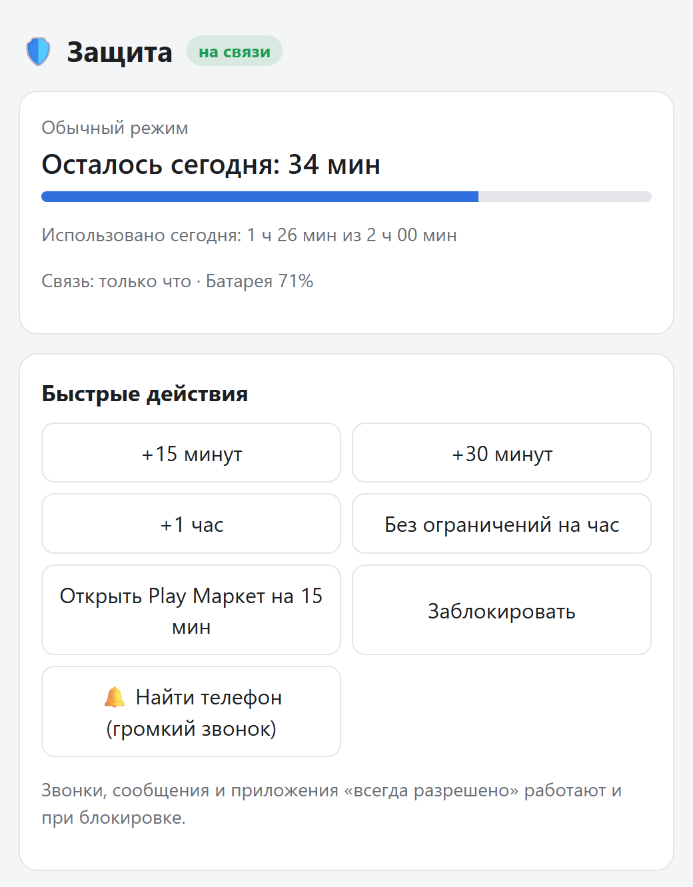
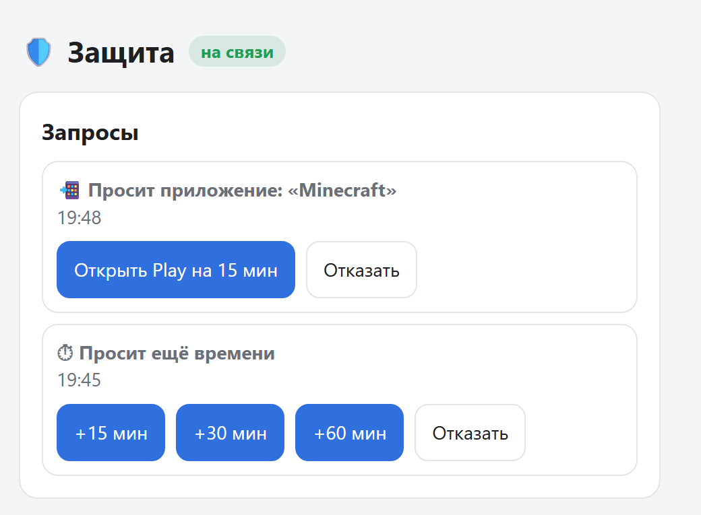
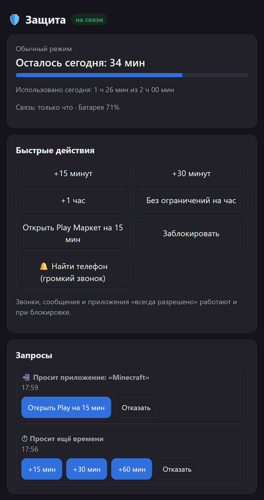
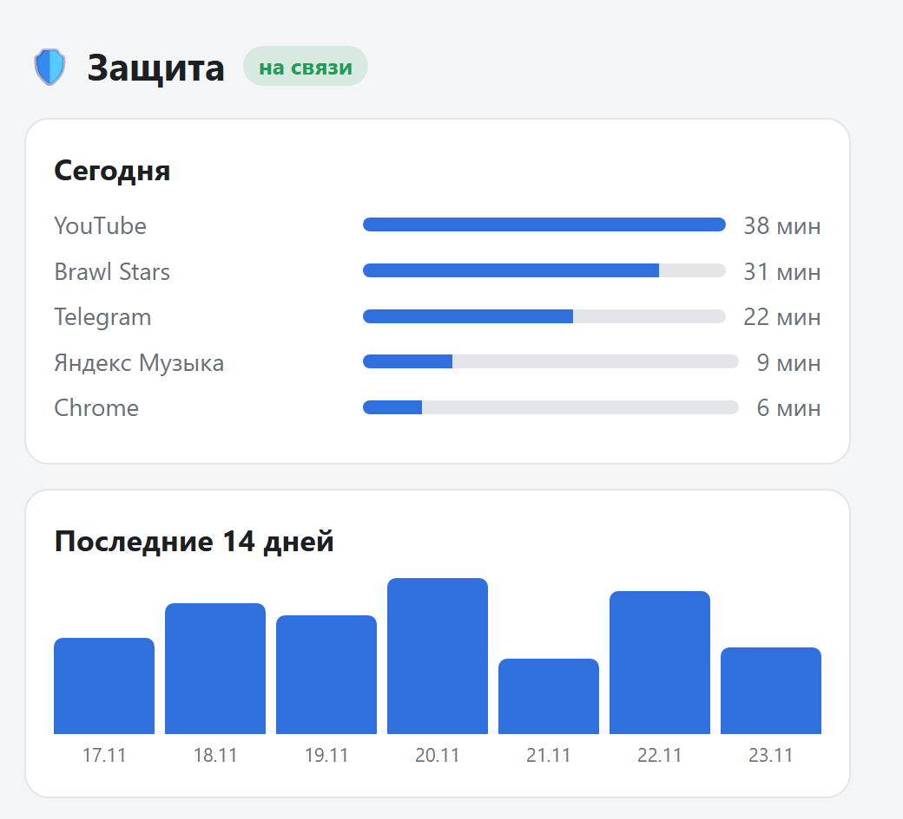
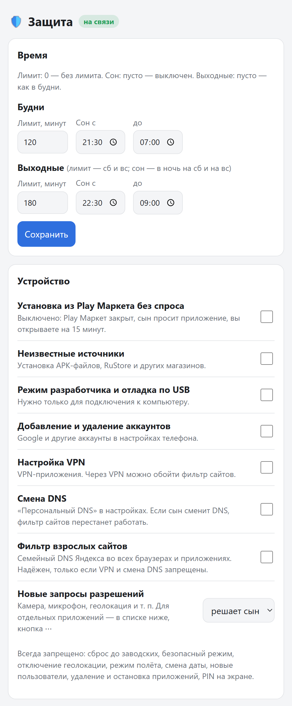
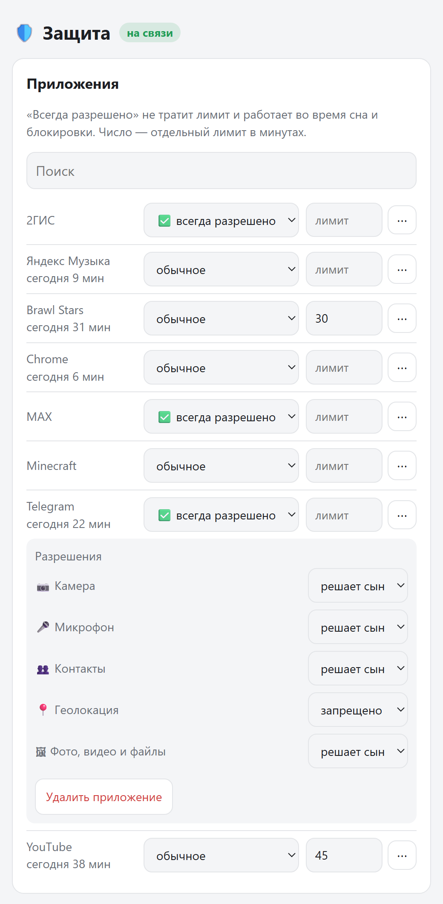
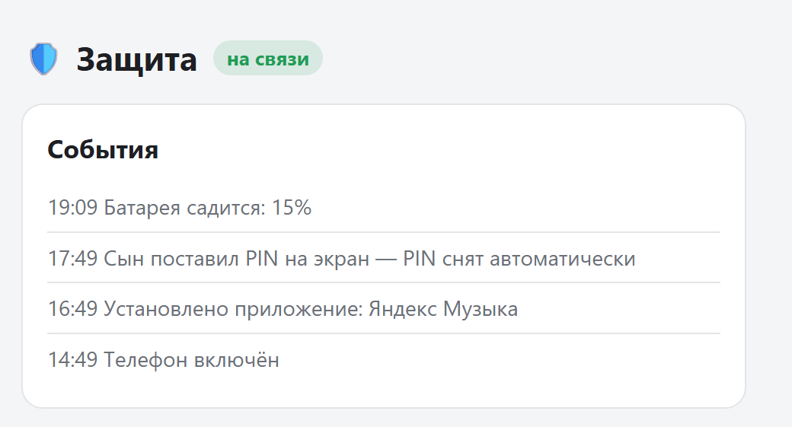
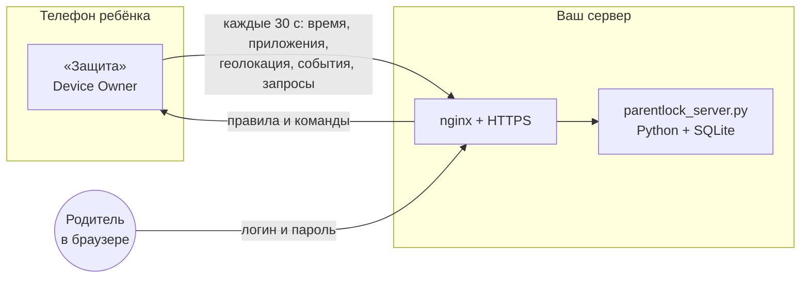

# 🛡️ Защита — родительский контроль, который нельзя снять сбросом

Свой аналог Google Family Link для Android: приложение-владелец телефона (Device Owner) плюс сайт, с которого родитель управляет телефоном ребёнка из любого браузера.

Сделано, когда ребёнок в очередной раз снял Family Link сбросом телефона до заводских настроек. Здесь сброс из настроек запрещён, PIN на экране ставить нельзя, а после сброса кнопками телефон требует Google-аккаунт родителя.

<p align="center">
  
  
  
</p>

## Что умеет

**Время**
- Дневной лимит, отдельно для будней и выходных.
- Режим сна по расписанию, отдельно для будних ночей и ночей на субботу и воскресенье.
- Отдельный лимит для любого приложения, например YouTube на 45 минут.
- «Всегда разрешено»: мессенджеры, звонки, школьные приложения работают и после лимита, и ночью.
- «+15 / +30 / +60 минут», «без ограничений на час», мгновенная блокировка.
- Ребёнку приходит уведомление с остатком времени и предупреждение за 5 минут до конца.

**Приложения**
- Блокировка любого приложения.
- Play Маркет закрыт: ребёнок просит приложение, родитель открывает магазин на 15 минут.
- Разрешения для каждого приложения: камера, микрофон, геолокация, контакты, звонки, SMS, фото и файлы.
- Удаление приложения с сайта.
- Установка APK из неизвестных источников и RuStore — только с разрешения родителя.

**Телефон**
- Местоположение раз в 5 минут и по кнопке, ссылка на Яндекс Карты.
- «Найти телефон»: громкий звонок на 30 секунд даже на беззвучном.
- Фильтр взрослых сайтов через семейный DNS Яндекса.
- Запросы ребёнка «ещё времени» и «нужно приложение» с кнопками «Разрешить» и «Отказать».
- События: телефон включён, установлено приложение, время кончилось, батарея садится, попытка поставить PIN.
- Обновление приложения прямо с сайта, без кабеля.
- Два родителя: у второго свой пароль и на телефоне, и на сайте. Управлять паролями может только основной.

**Что ребёнок сделать не может**
- Сбросить телефон из настроек, зайти в безопасный режим, добавить пользователя или «личное пространство».
- Отключить геолокацию, включить режим полёта, менять мобильную сеть, дату и время.
- Настроить VPN и сменить DNS, если родитель не разрешил это на сайте.
- Удалить, остановить или очистить любое приложение, удалить «Защиту».
- Поставить PIN или графический ключ: приложение сразу его снимает. Иначе ребёнок мог бы пройти проверку после сброса своим PIN.
- Отключить учёт времени: если отозвать у «Защиты» доступ к статистике, телефон сразу блокируется, а родитель видит событие.

## Скриншоты сайта

| Сегодня и история | Время и устройство | Приложения и разрешения |
|---|---|---|
|  |  |  |



Скриншоты сняты с демо-режима на вымышленных данных (`python server/parentlock_server.py demo`).

## Как устроено



- **`android/`** — приложение на Java без сторонних библиотек. Собирается без Gradle: `aapt2 → javac → d8 → apksigner`.
  - `Policy` — запреты владельца устройства, снятие PIN, DNS-фильтр.
  - `Enforcer` — считает время и решает, какие приложения сейчас приостановить (`setPackagesSuspended`).
  - `Usage` — время в приложениях по системной статистике.
  - `Sync` — обмен с сайтом, очередь событий и запросов, геолокация.
  - `Remote` — разрешения, удаление, звонок, самообновление.
  - `GuardService` — фоновая служба: проверка каждые 20 с, обмен каждые 30 с.
- **`server/`** — сайт: один файл на Python только из стандартной библиотеки и одна страница `index.html` без фреймворков.
- Если сервер недоступен, телефон продолжает работать по последним правилам. Сервер управляет, но не нужен для работы запретов.

## Честно об ограничениях

- **Family Link на этом телефоне работать не будет.** Android разрешает только одного владельца устройства. Детский Google-аккаунт без Family Link на телефон не добавить, поэтому для защиты от сброса нужен отдельный взрослый Gmail родителя. Детский аккаунт можно открывать через браузер.
- **Защита от сброса кнопками держится на FRP Google:** после сброса телефон требует Google-аккаунт, который был на нём. На телефоне под управлением Device Owner это не проверялось настоящим сбросом.
- **Выключенный или разряженный телефон** ничего не передаёт. Сайт покажет последнюю точку и время связи.
- **Уведомлений родителю нет**: о запросах ребёнка видно, когда открыт сайт, страница обновляется каждые 15 с.
- **Карта** — встроенная OpenStreetMap. Если она не грузится, есть ссылка на Яндекс Карты.
- Проверено на realme (realme UI, Android 15). На других оболочках возможны свои ограничения фоновой работы.

## Установка

### Что понадобится
- Android-телефон с Android 11 или новее, который можно сбросить до заводских.
- Компьютер с Android SDK (build-tools 36.1, platform android-36) и JDK 17+, например из Android Studio.
- Сервер с Ubuntu 22.04/24.04 и nginx. Своё доменное имя не обязательно: подойдёт бесплатное `<ip-через-дефисы>.sslip.io`.

### 1. Собрать приложение
```powershell
.\android\build.ps1
```
Получится `android/parentlock.apk`. При первой сборке создаётся ключ подписи `android/parentlock.jks`.

> ⚠️ **Сохраните `parentlock.jks` в надёжном месте.** Обновления ставятся только поверх приложения, подписанного тем же ключом. Без него придётся снимать защиту и ставить всё заново. Пароль ключа задаётся переменной `PARENTLOCK_KS_PASS`.

### 2. Подготовить телефон
Владельца устройства Android разрешает назначить только на телефон **без аккаунтов**.

1. Сбросьте телефон и при настройке **пропустите вход в Google и в аккаунт производителя**.
2. Включите «Для разработчиков» (7 раз нажать на «Номер сборки») и «Отладку по USB». На realme, OPPO и OnePlus включите там же «Отключить мониторинг разрешений».
3. Подключите телефон к компьютеру и выполните:
   ```powershell
   adb install android\parentlock.apk
   adb shell dpm set-device-owner com.parentlock/.AdminReceiver
   ```
4. Откройте «Защиту», задайте пароль родителя.
5. Выдайте «Защите» доступ к статистике: «Настройки → Приложения → Специальный доступ → Доступ к истории использования». Без него телефон заблокирован, так и задумано.

### 3. Поднять сайт
1. Скопируйте `server/deploy.env.example` в `server/deploy.env` и заполните адрес сервера, домен и SSH-ключ.
2. Если ключа на сервере ещё нет: `.\server\add-key.ps1`.
3. Установите сайт. Скрипт заводит системного пользователя, службу systemd, отдельный сайт в nginx и HTTPS через certbot. Остальные сайты на сервере не затрагиваются.
   ```bash
   bash server/deploy.sh
   ```
4. Задайте пароль для входа на сайт. Пароль вводится в терминале и нигде не отображается.
   ```powershell
   .\server\reset-password.ps1      # основной родитель
   .\server\reset-password.ps1 2    # второй родитель (или на сайте в «Настройках»)
   ```

### 4. Связать телефон с сайтом
На сайте нажмите «Получить код». На телефоне: «Защита» → «Вход для родителя» → «Сайт управления» → адрес сайта и код. Через полминуты на сайте появятся данные.

### 5. Закрыть телефон
1. Добавьте на телефон **отдельный Gmail родителя**: «Настройки → Аккаунты → Добавить». Это защита от сброса кнопками.
2. На сайте задайте лимиты, сон и «всегда разрешённые» приложения.
3. В «Защите» на телефоне нажмите **«Выключить режим настройки»**. После этого Play Маркет, APK, аккаунты и отладка открываются только с сайта.
   Не оставляйте режим настройки включённым надолго: пока он включён, ребёнок может поставить VPN, клонер приложений и другие средства обхода.

## Обновления
```bash
powershell .\android\build.ps1
bash server/publish-apk.sh
```
Затем на сайте нажмите «Обновить приложение на телефоне». Сайт обновляется повторным запуском `bash server/deploy.sh`.

## Демо и тесты
```bash
python server/parentlock_server.py demo --port 18770   # сайт с вымышленными данными, без входа
python tests/test_server.py                            # сквозной тест: вход, связь с телефоном, правила, команды
python tests/screenshots.py                            # пересобрать скриншоты (нужны Chrome и Pillow)
```

## Как снять защиту
«Защита» → «Вход для родителя» → «Снять защиту и удалить владельца». Все запреты снимаются, приложение перестаёт быть владельцем, после этого его можно удалить.

## Безопасность
- Пароли родителей хранятся на сервере как PBKDF2-SHA256 (200 000 итераций). Смена пароля завершает сессии только этого родителя. Вход защищён от подбора, сессия в HttpOnly и Secure cookie.
- Телефон связывается с сайтом одноразовым кодом и дальше ходит со случайным токеном, на сервере хранится только его хеш.
- Пароль родителя в приложении хранится как PBKDF2. После 5 ошибок вход блокируется на 5 минут и дольше.
- Сайт слушает только `127.0.0.1`, наружу его отдаёт nginx по HTTPS.
- Обновление с сайта Android ставит, только если подпись совпадает с установленной.

## Структура
```
android/          приложение (Java, без Gradle)
  build.ps1       сборка APK
  src/com/parentlock/
server/
  parentlock_server.py   сайт и API (Python, только стандартная библиотека)
  index.html             интерфейс родителя
  deploy.sh              установка и обновление на сервере
  publish-apk.sh         выложить новую версию приложения на сайт
  reset-password.ps1     сменить пароль сайта
  add-key.ps1            добавить SSH-ключ на сервер
  deploy.env.example     пример настроек сервера
tests/            тест сервера и скриншоты
docs/screenshots/
```

## Лицензия
[MIT](LICENSE)
